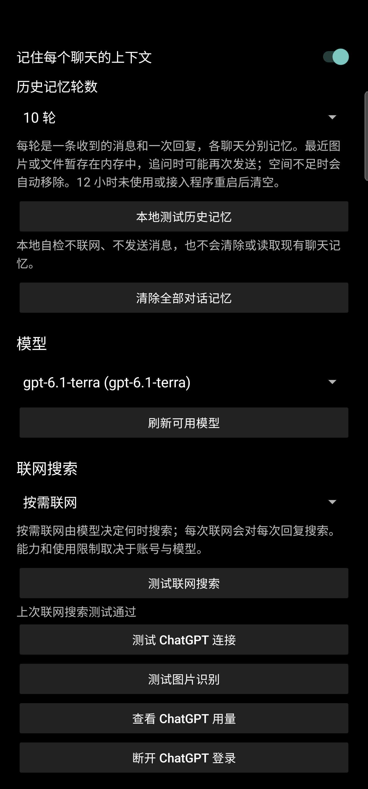

# 微插 ChatGPT 接入

> **协议风险提示（2026-11-05）**：本项目通过 Xposed 在VX进程内接入，目前未找到平台方对本项目的书面授权。[平台方VX软件许可及服务协议](https://oper.my-qcloud.com/cgi-bin/readtemplate?lang=zh_CN&s=default&t=weixin_agreement)第 8.2.1.4、8.2.1.6 条对未经授权的第三方插件、自动化操作及相关工具传播设有限制；本项目是否符合这些条款尚未得到平台方确认。建议在获得明确授权或核实前暂停使用及传播；免责声明本身不能替代授权。现有仓库保留供维护者评估后续处理。

一个面向 Android 的独立 Xposed 接入模块：把微插的聊天机器人自动回复接到经用户授权的 ChatGPT 模型。它保留微插原有的自动回复范围、关键词、时段和次数等规则；微插、VX和 LSPosed 均为独立项目，本项目不是它们的官方产品。

> 当前为面向已有环境的实验性项目。VX、微插和框架版本变化可能使内部接口失效；不要认为所有设备、分身或账号均已验证。请先阅读[部署指南](部署指南.md)、[数据与安全说明](工具接入与数据.md)和[项目声明](项目声明与联系.md)。

## 功能

- ChatGPT 授权登录、模型选择及连接测试；具体使用资格、可选模型和限额以 OpenAI 与账号实际状态为准。
- 根据微插规则处理文字、图片、文件和自定义表情；图片及文件需模型支持。GIF 最多抽取四帧，并不是视频理解。
- 每个聊天保留 1～20 轮短期上下文；可关闭或清除。媒体缓存只在内存中暂存，12 小时未使用或进程退出后清空。
- 联网搜索可关闭、按需或每次使用；可用性取决于账号、模型和服务。
- “回复风格”支持手动填写风格说明和示例、独立试写及启用；可参考[聊天记录提炼风格](聊天记录与回复风格.md)。这不是模型训练，程序不会自动读取VX历史聊天。
- VX语音先由VX转文字，再把文字交给模型；普通音频文件和视频没有接入。

## 验证状态

已查看的单机环境为 Android 12、VX 8.0.49、微 X 3.0、LSPosed 1.9.3_mod（7244）Zygisk、接入模块 0.2.24-reply-style；这不是兼容列表。此前在该设备和一个主VX环境下，旧版本完成过文字、普通图片、PDF、XLSX、自定义 GIF 和多轮上下文的真实收发；当前版本的文字收发、风格保存与模型试写经过测试，**未重跑完整媒体收发**。真实语音端到端、猜拳/骰子等互动表情、长时间息屏以及重启后自动收发仍待验证。文件大小上限选项最高 20 MB，但没有完成真实 20 MB 上传验收。请勿将上述结果外推到所有版本。

## 从这里开始

1. [部署指南](部署指南.md)：准备环境、构建和安装、配置微插、基本验收。
2. [工具接入与数据说明](工具接入与数据.md)：权限、各组件、链接与数据流。
3. [聊天记录与回复风格](聊天记录与回复风格.md)：使用个人聊天记录形成可编辑的风格说明。
4. [故障排查](故障排查.md)：登录、自动回复、媒体、后台与回退。

## 开发环境

Android 项目 `minSdk 26`、`compileSdk 35`、`targetSdk 35`；Java 17，Android Gradle Plugin 8.7.2，Gradle Wrapper 8.10.2。Windows 下可在项目根目录运行：

```powershell
.\gradlew.bat testDebugUnitTest assembleRelease
```

首次构建需按需下载依赖并配置 Android SDK；构建前请阅读部署指南中的签名说明。设备的 Android 版本、VX和微插的实际兼容性还需单独确认。测试结果不能代替真机验收。

## 真机界面

以下为实际设备截图，状态栏已遮挡；画面上的设置仅为截图时的示例。含目标平台明确名称或图标的截图已从页面隐藏。



## 公开版构建说明

公开版不含来源待核实的语音与 GIF 内部自测素材，相应开发自测不可用；正常运行路径和 JVM 单元测试不依赖这些素材。公开版源码在本机离线通过 48 项 JVM 测试及无签名 release 构建；单独签名的公开 APK 尚未在另一台手机完成端到端验收。详见 [第三方说明](THIRD_PARTY_NOTICES.md)。

## 下载与许可证

- [版本与 APK 下载](https://github.com/TZZ520/Wechat-ChatGPT-Bridge/releases)：公开 APK 的独立签名与旧个人测试版不同，无法直接覆盖；安装前先阅读[部署指南](部署指南.md)。
- 首发安装包 SHA-256：`D4A63F316AA5E3ED55F72FF2415C5CC9EEE5D7DDBC657048B51B3C728F02859C`。公开包尚未完成独立真机端到端验收。
- 项目自有内容采用 [MIT 许可证](LICENSE)，第三方组件按其原有许可使用，见 [第三方说明](THIRD_PARTY_NOTICES.md)。

## 免责声明

本项目是独立开发的实验性工具，与平台方、VX、微 X、LSPosed 和 OpenAI 均无官方合作或从属关系，相关名称和商标归各自权利人所有。模块通过用户自行配置的 Xposed 兼容框架，在用户设备的VX进程内进行 Hook 和消息适配；不需要侵入或修改平台方服务器。它依赖第三方应用内部实现，兼容性和账号使用风险不能保证，使用者应自行了解并遵守适用法律及相关服务规则。

程序运行在手机上，但并非完全离线：符合自动回复规则的消息、启用的风格内容以及所选图片或文件可能发送给 OpenAI；VX语音先使用VX的转写服务。使用前请了解数据流并确保有权处理相关内容，详见[工具接入与数据说明](工具接入与数据.md)。请先备份配置，在受控范围内测试，使用者自行判断是否启用并对使用行为负责。

## 需求反馈与定制开发

欢迎通过 [GitHub Issues](https://github.com/TZZ520/Wechat-ChatGPT-Bridge/issues) 提出需求、反馈问题或分享兼容情况。如果有个性化功能或接入需求，也可以描述使用场景，讨论是否适合定制开发；具体范围、时间、实现方式及是否收费由双方另行沟通。请不要在公开反馈中留下账号、令牌、联系人或聊天内容。

## 自愿支持算力

如果项目对你有帮助，欢迎自愿支持算力与维护成本。赞助完全自愿，不影响公开源码的使用和问题反馈，也不代表承诺实现某项功能。**收款入口正在整理**，请勿向未经项目确认的账号转账。
