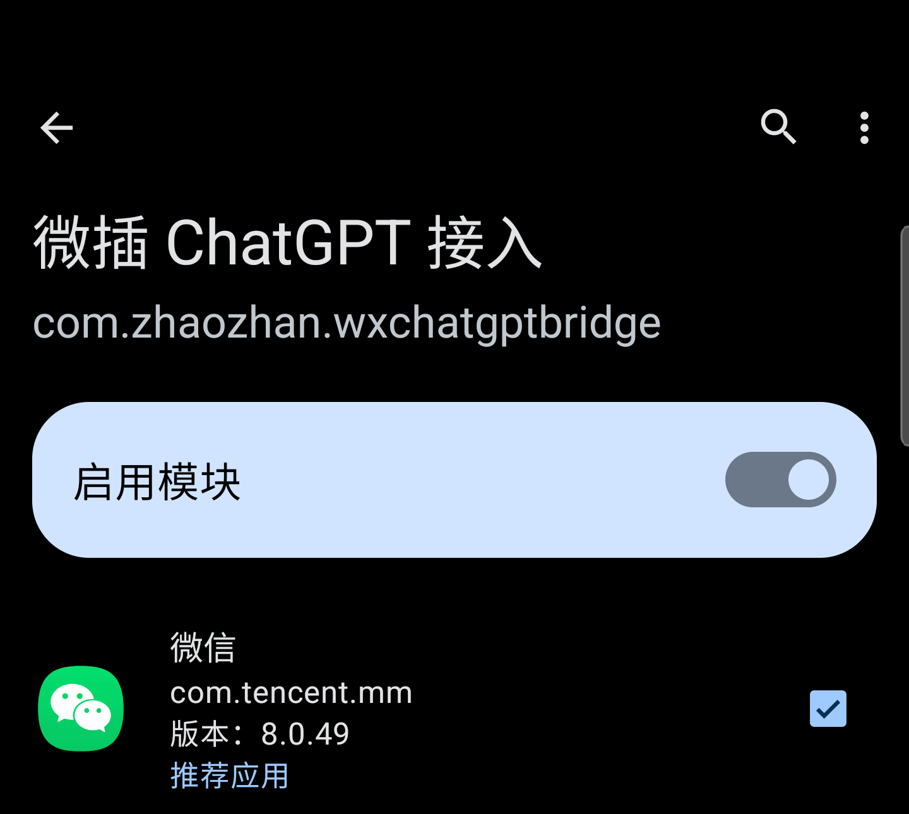

# 部署指南

## 1. 准备环境

- 一部已能正常运行微信及微插自动回复的 Android 设备，保留原有配置与备份。项目声明 Android 8.0（API 26）起，但框架和微信自身的兼容范围需分别核实。
- 已配置且可正常使用的 Xposed 兼容框架，例如 [LSPosed](https://github.com/LSPosed/LSPosed)，及已启用的 [微 X / 微插模块](https://modules.lsposed.org/module/cn.android.x/)。不同 Android 版本与 Root/框架方案的安装细节不同，请参照各自项目文档；本项目不提供或替换微信和微插安装包。
- 可以完成 OpenAI 授权的账号、网络与浏览器。账号资格、套餐、使用额度和功能以 [OpenAI 开源应用套餐授权指南](https://developers.openai.com/siwc/token-sharing-open-source)及服务实际返回为准；不能保证所有账号都能调用。
- 从可信来源获取接入模块 APK，或自行构建。多用户/微信分身需要分别核实安装用户和框架作用域，不能以主用户成功推断分身成功。

## 2. 从源码构建

安装 JDK 17 和 Android SDK 平台 35，配置 `ANDROID_HOME` 或本地 `local.properties`，安装必要的 SDK 构建工具。项目使用 Gradle 8.10.2、AGP 8.7.2、Xposed API 82 和 JUnit；首次构建需要能够访问配置的依赖仓库。在 Windows 项目根目录执行：

```powershell
.\gradlew.bat testDebugUnitTest assembleRelease
```

成功后查看 `app/build/outputs/apk/release/`。公开源码的 release 构建默认不签名，产物需由发布者自行签名后才能安装。公开发布的安装包使用独立发布密钥，与此前的个人测试版签名不同，不能直接覆盖该个人测试版；不要通过卸载来绕过签名差异，否则会删除接入程序的本地登录和风格设置。后续覆盖更新需要签名一致且版本号满足 Android 要求。请安全保存密钥，勿上传密钥或密码，并核对发布产物签名和哈希。

## 3. 安装并激活

1. 保留微信、微插和现有修复模块的备份。安装独立的“微插 ChatGPT 接入”APK；不要替换或卸载原有微信、微插或修复模块。
2. 打开 LSPosed 的“模块”，选择“微插 ChatGPT 接入”，开启该模块；在作用域列表勾选目标微信 `com.tencent.mm`。无需因为本模块勾选其他应用。接入模块和微插模块是两个独立模块，各自需要按照实际环境启用；多用户或微信分身应核对所在用户空间。



3. 重启微信进程以加载模块。若已有重要任务进行中，先保存再操作；不要清除微信数据。版本不兼容时可先停用接入模块恢复原设置。

## 4. 授权与微插配置

1. 打开桌面上的“微插 ChatGPT 接入”，选择“使用 ChatGPT 登录”，在浏览器完成授权并返回。核对授权页面来源，不要在第三方聊天中发送密码、令牌或回调地址。
2. 刷新并选择账号可用模型，打开“允许微插使用 ChatGPT 套餐”，先使用“测试 ChatGPT 连接”。测试向服务发送测试内容，不会向微信联系人发消息。
3. 在微信内进入 **设置 → 更多 → 自动回复 → 通用设置 → 设置聊天机器人**，选择 `OpenAI ChatGPT`；也可通过其中的“ChatGPT 登录与模型”进入接入设置。不同微插版本页面名称可能变化。
4. 按需打开微插自动回复总开关、通用设置和聊天机器人，并检查联系人范围、关键词、时间、最多回复次数及签名。先限制到自己的测试账号，避免误发。
5. 从自己的另一账号发送普通测试消息，核对是否收到回复；再按需逐项测试图片、文件和上下文。不要拿真实敏感信息作为测试样本。

## 5. 常用设置

- 图片、表情、语音、文件和记忆各有开关；表情识别依赖图片开关。文件大小可选 1、2、5、10、20 MB。
- 历史记忆为每个聊天最近 1～20 轮；与微插“最多回复次数”是不同设置。
- 可在“回复风格”输入说明、先试写再启用保存；涉及聊天记录的操作见[风格指南](聊天记录与回复风格.md)。
- 可根据系统设置允许微信和接入程序后台运行，但这不保证强行停止、系统休眠或设备重启后的收发。

要停止接入，可先关闭接入设置中的授权使用开关；需要完全停止时在 LSPosed 停用本模块并重新加载微信。卸载接入程序会删除其本地登录数据和风格设置；签名不同的安装包也无法直接覆盖，切勿为解决问题随意清除微信数据。
